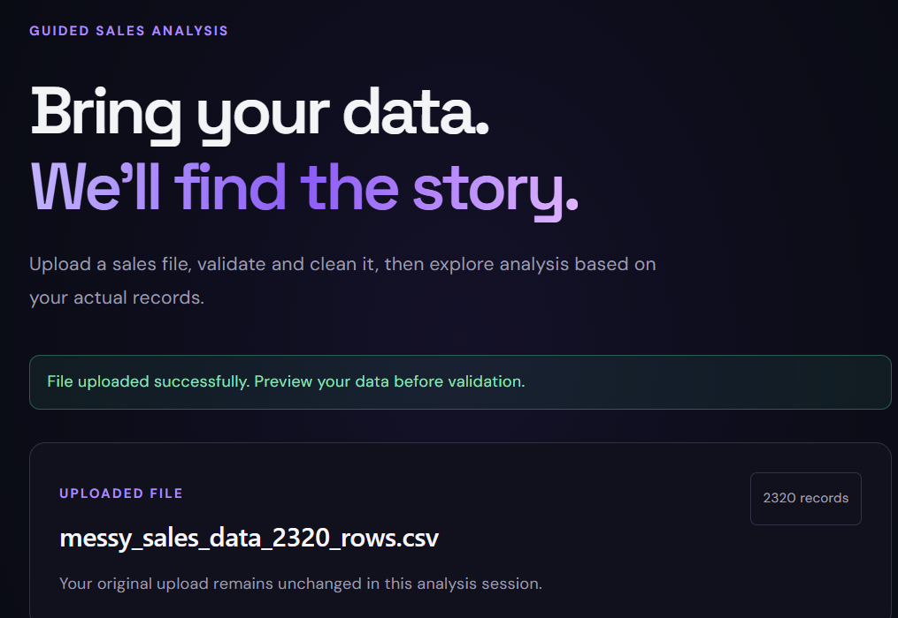
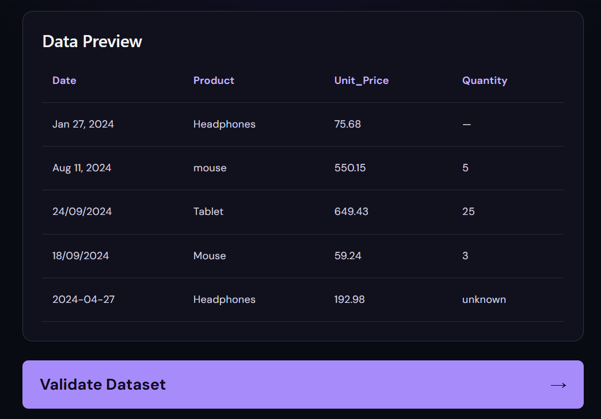
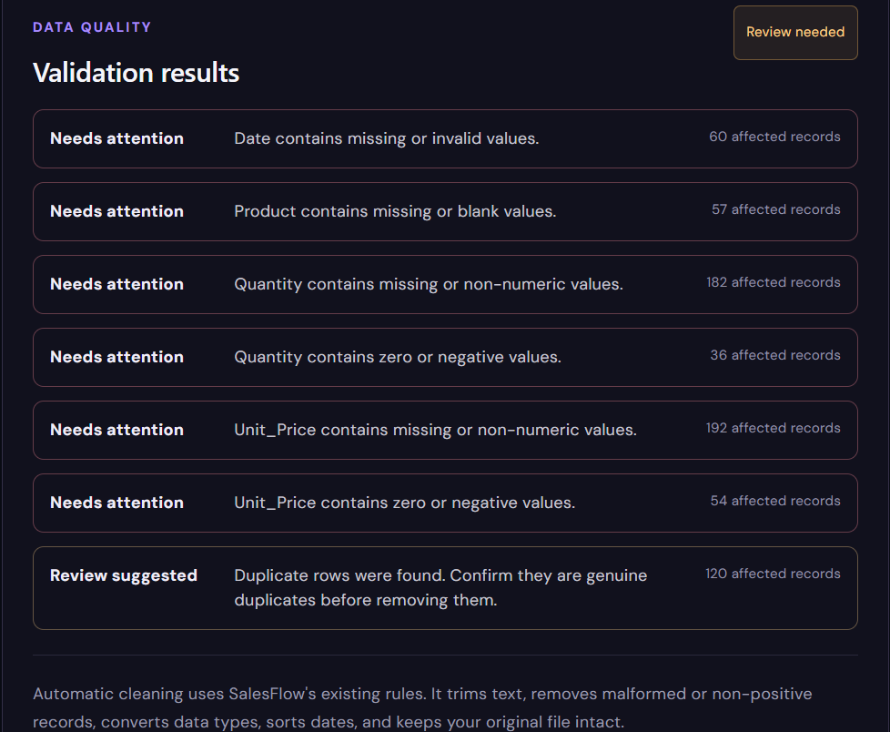
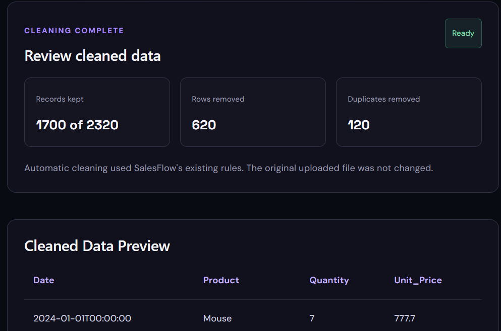
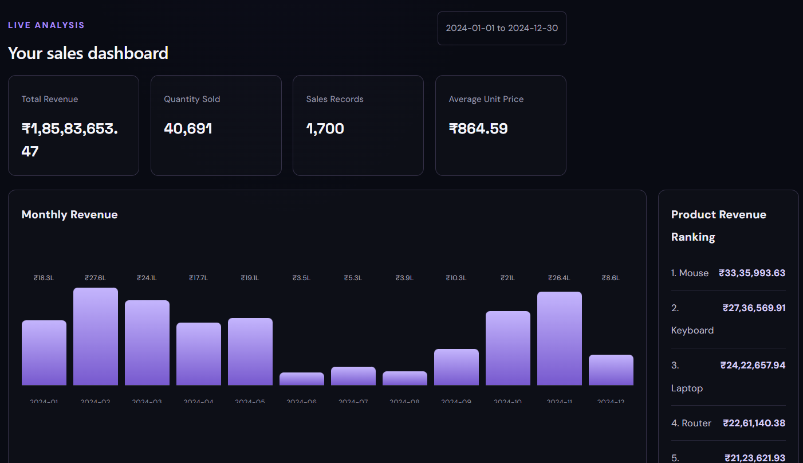
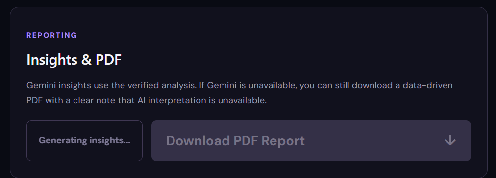
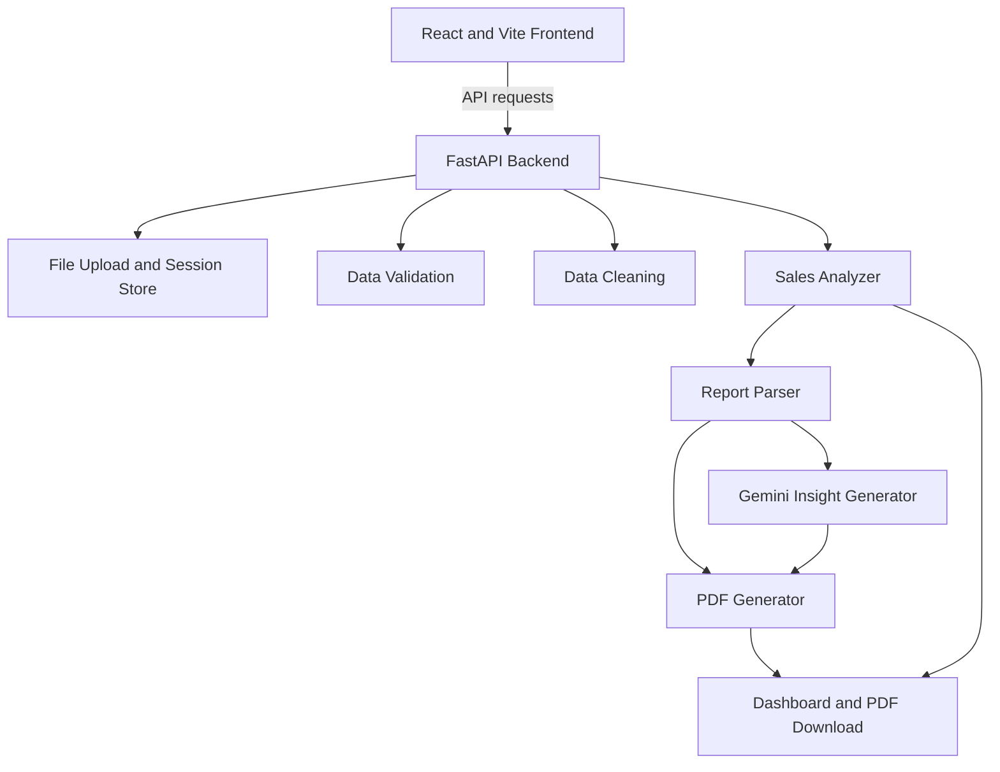
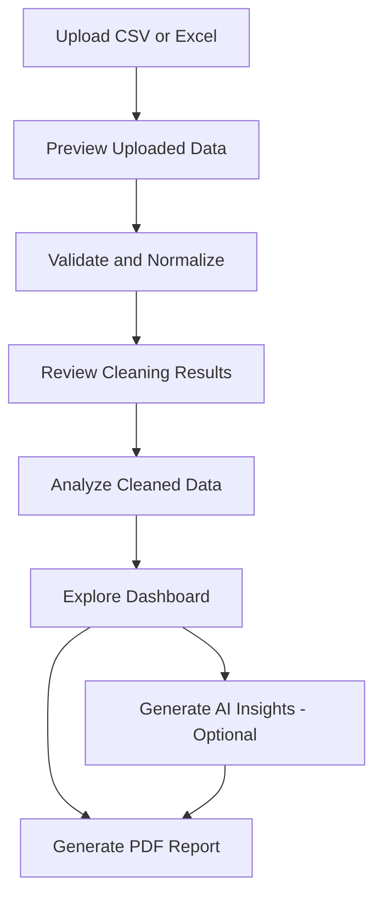

# SalesFlow V1

### Sales Data Analysis & AI-Assisted Reporting

SalesFlow is a local sales analytics application that transforms CSV and Excel data into actionable sales metrics, interactive visualizations, and structured PDF reports. It combines data validation and cleaning with automated analysis and optional AI-generated business insights.

Built with **React, Vite, FastAPI, Pandas, and ReportLab**, SalesFlow is designed to make sales-data preparation and reporting more organized, repeatable, and easier to understand.

> **Project status:** Version 1 — local application
> **Author:** Sumit Shastri
> **Deployment:** Not yet deployed

---

## ✨ Features

| Feature                  | Description                                                                         |
| ------------------------ | ----------------------------------------------------------------------------------- |
| 📂 File Upload           | Upload CSV and Excel files (`.csv`, `.xlsx`, `.xls`).                               |
| 👀 Data Preview          | Preview uploaded records before processing.                                         |
| ✅ Data Validation        | Normalize column names and identify missing or invalid values.                      |
| 🧹 Data Cleaning         | Clean a working copy and report the changes made.                                   |
| 📊 Sales Analysis        | Calculate overall KPIs, product performance, time-based trends, and growth metrics. |
| 📈 Interactive Dashboard | Explore sales metrics and visualizations for the current analysis.                  |
| 🤖 AI-Assisted Insights  | Generate business-oriented interpretations using Google Gemini when configured.     |
| 📄 PDF Reporting         | Generate a structured, eight-section sales-performance report.                      |

**Data integrity:** The original upload is preserved separately from the normalized working data and cleaned dataset.

**AI is optional:** Core analysis and PDF generation can operate without Gemini-generated insights.

---

## 🖥️ Application Preview

### File Upload



Upload file .


### Data Preview



This Shows the preview of data before start validation.


### Validation results




### Clean Data Review & Preview




### Dashboard




### Report AI Insights




---

## 🛠️ Technology Stack

| Layer            | Technology                       | Purpose                                       |
| ---------------- | -------------------------------- | --------------------------------------------- |
| Frontend         | React 19                         | User interface and workflow                   |
| Frontend tooling | Vite 8                           | Development server and production builds      |
| Language         | JavaScript                       | Frontend application logic                    |
| Styling          | CSS                              | Layout and visual presentation                |
| Backend          | FastAPI                          | API endpoints and workflow orchestration      |
| ASGI server      | Uvicorn                          | Running the backend                           |
| Data processing  | Pandas, NumPy                    | Loading, cleaning, and analyzing tabular data |
| Excel support    | OpenPyXL                         | Reading supported Excel workbooks             |
| AI integration   | Google Gemini via `google-genai` | Generating written insights                   |
| Visualization    | Matplotlib                       | Generating report charts                      |
| PDF generation   | ReportLab                        | Producing downloadable PDF reports            |

### Verified development environment

The project was reported as tested with:

* **Python:** 3.14.7
* **Node.js:** 24.21.0
* **npm:** 11.19.0

These are the reported development versions, not a guarantee that every other version is compatible.

---

## 🏗️ Architecture

SalesFlow separates the frontend, API layer, data-processing services, and report-generation services.



The Gemini insight generator is optional. The report workflow can produce a PDF without AI-generated interpretation.

During development, the frontend uses relative `/api` requests, which Vite proxies to the backend at `http://localhost:8000`. The backend also has a CORS policy configured for the development frontend origins.

---

## 📁 Project Structure

The following is the documented structure of the current project. Refer to the actual repository for the definitive list of files.

```text
SalesFlow/
├── backend/
│   ├── app/
│   │   ├── main.py
│   │   ├── api/
│   │   │   ├── upload.py
│   │   │   └── workflow.py
│   │   └── services/
│   │       ├── loader.py
│   │       ├── validator.py
│   │       ├── cleaner.py
│   │       ├── analyzer.py
│   │       ├── session_store.py
│   │       └── report/
│   │           ├── report_parser.py
│   │           ├── report_insight_generator.py
│   │           └── report_pdf_generator.py
│   ├── tests/
│   └── requirements.txt
├── frontend/
│   ├── src/
│   │   ├── App.jsx
│   │   ├── api.js
│   │   └── components/
│   │       └── UploadPage.jsx
│   ├── package.json
│   └── vite.config.js
├── data/
├── docs/
├── .gitignore
└── README.md
```

### Important modules

| File                          | Responsibility                                                           |
| ----------------------------- | ------------------------------------------------------------------------ |
| `main.py`                     | Creates the FastAPI application and configures middleware.               |
| `upload.py`                   | Handles file uploads and data previews.                                  |
| `workflow.py`                 | Coordinates validation, cleaning, analysis, insights, and report routes. |
| `loader.py`                   | Loads supported CSV and Excel files.                                     |
| `validator.py`                | Normalizes column names and validates required fields and values.        |
| `cleaner.py`                  | Implements reusable data-cleaning operations.                            |
| `session_store.py`            | Manages session-local original and processed files.                      |
| `analyzer.py`                 | Calculates sales metrics, product rankings, trends, and growth.          |
| `report_parser.py`            | Prepares structured report content from analysis results.                |
| `report_insight_generator.py` | Requests and validates Gemini-generated insights.                        |
| `report_pdf_generator.py`     | Generates the PDF sales report.                                          |
| `api.js`                      | Provides the shared frontend API client.                                 |
| `UploadPage.jsx`              | Implements the upload workflow and associated user interface.            |

For a deeper explanation of the modules and their interactions, see [`PROJECT_GUIDE.md`](PROJECT_GUIDE.md), if that file is present in the repository.

---

## ⚙️ Prerequisites

Install the following:

* Python 3.14, matching the reported local development environment.
* Node.js 24 and npm.
* Git, if you want to clone and manage the repository.
* A Google Gemini API key if you want AI-generated insights.

Check your installed versions:

```powershell
python --version
node --version
npm --version
```

---

## 🚀 Installation

### 1. Get the project

If you are cloning the repository:

```powershell
git clone https://github.com/Sumit-Shastri/SalesFlow.git
cd SalesFlow
```

Alternatively, open your existing local project directory.

### 2. Install backend dependencies

Open PowerShell:

```powershell
cd D:\Projects\SalesFlow\backend
```

If the project does not already have a virtual environment, create one:

```powershell
python -m venv .venv
```

Install the dependencies:

```powershell
.\.venv\Scripts\python.exe -m pip install -r requirements.txt
```

If your existing `.venv` is already configured, reuse it instead of recreating it.

### 3. Install frontend dependencies

Open a second terminal:

```powershell
cd D:\Projects\SalesFlow\frontend
npm install
```

Do not commit `.venv`, `node_modules`, or environment files containing secrets.

---

## 🔐 Environment Configuration

Gemini-generated insights require a valid API key. File upload, validation, cleaning, analysis, and PDF generation without AI insights do not require Gemini credentials.

Create a file named `.env` inside the backend directory:

```text
backend/.env
```

Add your key:

```dotenv
GEMINI_API_KEY=your_api_key_here
```

Replace the placeholder with your own key.

Keep `.env` private and excluded from Git. Never put the Gemini key in frontend code or publish it in screenshots, logs, or documentation.

If the key is missing, SalesFlow should report a configuration error rather than fabricate AI-generated content.

---

## ▶️ Running SalesFlow Locally

### Start the backend

In the first PowerShell terminal:

```powershell
cd D:\Projects\SalesFlow\backend
```

Run:

```powershell
.\.venv\Scripts\python.exe -m uvicorn app.main:app --reload --host 127.0.0.1 --port 8000
```

The backend should be accessible at:

* **API base:** `http://127.0.0.1:8000`
* **Interactive API documentation:** `http://127.0.0.1:8000/docs`

Keep the terminal open while using the application.

### Start the frontend

In a second terminal:

```powershell
cd D:\Projects\SalesFlow\frontend
npm run dev
```

Open:

**Frontend:** `http://localhost:5173`

The exact URLs depend on the local configuration. If either service uses a different port, use the URL printed by the corresponding command.

---

## 🔄 Application Workflow

The intended user journey is:



### How the data is handled

1. The user uploads a supported file.
2. SalesFlow displays a preview of the uploaded records.
3. Preview values that are missing are represented as JSON `null`. This does not clean or delete source records.
4. Validation normalizes the column names and checks the data.
5. The normalized working data is saved separately.
6. The cleaning stage creates a cleaned copy and reports its changes.
7. The analyzer processes the cleaned dataset.
8. The dashboard displays the analysis results.
9. Gemini insights can be generated when configured.
10. The PDF generator produces the sales report.

Analysis should use the cleaned dataset associated with the current session, rather than unrelated sample data.

---

## 📊 Analysis Methodology

SalesFlow focuses on four core fields:

| Column       | Purpose                              |
| ------------ | ------------------------------------ |
| `Date`       | Identifies when a sale occurred.     |
| `Product`    | Identifies the product sold.         |
| `Quantity`   | Represents the number of units sold. |
| `Unit_Price` | Represents the unit selling price.   |

### Revenue calculation

Revenue is derived for each record:

$$
\text{Revenue} = \text{Quantity} \times \text{Unit Price}
$$

### Overall metrics

The analyzer calculates metrics including:

* **Total revenue:** Sum of record-level revenue.
* **Total quantity:** Sum of sold quantities.
* **Sales records:** Number of records in the cleaned dataset.
* **Average unit price:** Arithmetic mean of `Unit_Price`.

### Product analysis

Product-level summaries include revenue, quantity, record count, weighted average selling price, and revenue contribution.

### Time analysis

Daily and monthly groupings support sales comparisons over time, including revenue, quantity, and record counts.

### Performance and growth

The analyzer ranks products by measures such as revenue, quantity, contribution, and average selling price. Growth analysis calculates month-over-month changes in revenue and quantity.

Growth percentages may be unavailable when there is insufficient comparison data or a zero baseline. Such cases should not be interpreted as meaningful growth rates.

---

## 🤖 AI Insights and PDF Reporting

SalesFlow can use Google Gemini to generate written interpretations of the sales analysis.

### Insight generation

The report workflow loads the saved analysis and passes the relevant data to `report_parser.py`. The parser prepares structured report information, including KPI summaries, time-based analysis, growth metrics, and chart-related content.

The insight generator then requests structured output from Gemini through the `google-genai` SDK.

The application validates the generated response before using it in the report workflow.

A valid API key and network access are required for live AI generation.

### PDF generation

The PDF generator uses ReportLab and Matplotlib to create a formatted report.

The intended report contains eight major sections:

1. Cover page
2. Executive summary
3. Overall sales performance
4. Product analysis
5. Time and trend analysis
6. Growth analysis
7. Findings and recommendations
8. Conclusion and areas worth investigating

The PDF can be generated without AI insights. In that case, the report should communicate that AI interpretation was unavailable instead of presenting fabricated recommendations.

**Verification note:** The repository's reported local checks verified PDF generation without AI insights. Live Gemini generation was not verified in that environment.

---

## 🧪 Testing

### Run backend tests

```powershell
cd D:\Projects\SalesFlow\backend
.\.venv\Scripts\python.exe -m pytest -q
```

### Check Python compilation

```powershell
.\.venv\Scripts\python.exe -m compileall -q app
```

### Build the frontend

```powershell
cd D:\Projects\SalesFlow\frontend
npm run build
```

### Reported verification results

The development workflow reported the following checks:

* Eight existing backend tests passed.
* Python compilation passed.
* The frontend production build passed.
* CSV and genuine Excel workbook processing was checked.
* Structured validation errors were checked.
* Analysis output was checked.
* Missing-Gemini-key handling was checked.
* PDF output was checked for a valid PDF signature.

These checks do not establish that every possible dataset, external API call, or deployment environment works.

The existing test suite was reported to contain eight cleaner-focused tests. Live Gemini generation was not verified in that environment.

---

## 🧰 Troubleshooting

| Problem                           | What to check                                                                                                            |
| --------------------------------- | ------------------------------------------------------------------------------------------------------------------------ |
| Backend does not start            | Confirm the virtual environment is available, dependencies are installed, and port 8000 is free.                         |
| Frontend cannot reach the backend | Start FastAPI first and verify the proxy configuration in `vite.config.js`.                                              |
| File upload fails                 | Confirm that the file is supported and is a valid CSV or Excel workbook.                                                 |
| Excel file cannot be read         | A file renamed to `.xlsx` is not necessarily a valid Excel workbook.                                                     |
| Required columns are missing      | Check the column names and the normalization rules in `validator.py`.                                                    |
| Preview contains blank cells      | Missing values can appear as `null` in the preview; inspect validation results to understand the underlying data issues. |
| Gemini insights are unavailable   | Check `GEMINI_API_KEY`, network access, and the backend error message. Never expose the key.                             |
| PDF generation fails              | Verify the backend dependencies and confirm that analysis has completed before requesting the report.                    |
| Frontend changes do not appear    | Refresh the browser and check the Vite terminal for compilation errors.                                                  |

For persistent errors, inspect the backend terminal and browser developer console. Use the actual error message to identify the failing stage instead of changing unrelated modules.

---

## ⚠️ Current Limitations

* **Local execution:** The application is intended to run locally and has not been deployed.
* **Temporary sessions:** Uploaded and processed files are managed using local session storage rather than a persistent database.
* **Dashboard filtering:** The current dashboard does not provide a date-range filter; it displays the analysis period associated with the current cleaned upload.
* **Gemini dependency:** AI-generated insights require a valid API key and network access. Live generation was not verified in the reported environment.
* **Test fixtures:** Some existing files with an `.xlsx` extension were reported to contain plain text rather than valid Excel workbook data. Genuine Excel workbooks were tested separately.

These limitations describe the reported Version 1 state and should be updated if the implementation changes.

---

## 🚀 Future Improvements — Version 2

Possible enhancements include:

* Interactive date-range and product filters.
* Additional dashboard visualizations.
* More advanced sales comparisons.
* Persistent storage for analysis sessions.
* User authentication and multi-user support.
* Scheduled report generation.
* Expanded reporting and export options.

These are future ideas, not claims about existing functionality.

---

## 👨‍💻 Author

**Sumit Shastri**

SalesFlow V1 — Sales Data Analysis and AI-Assisted Reporting

Project repository: [Sumit-Shastri/SalesFlow](https://github.com/Sumit-Shastri/SalesFlow)

---

## 📄 License

No license has been specified here.
